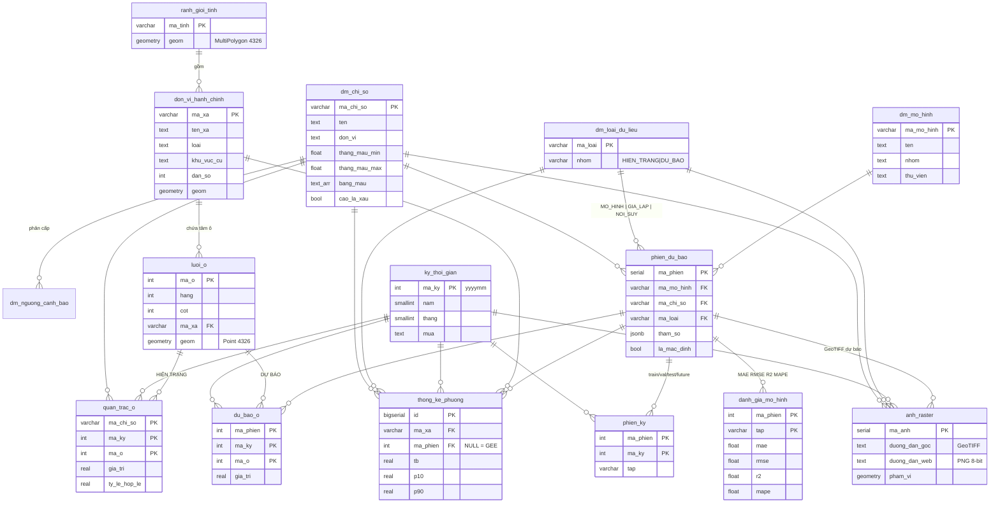

# Thiết kế CSDL PostgreSQL/PostGIS — giám sát & dự báo LST · NDVI · TVDI TP.HCM

Schema: **`vientham`** (file tạo: `database/schema.sql`). Hệ toạ độ lưu trữ EPSG:4326; lưới ô dựng trên ảnh gốc EPSG:32648 (UTM 48N).

## 1. Yêu cầu thiết kế và cách đáp ứng

| Yêu cầu | Cách đáp ứng trong CSDL |
|---|---|
| Quản lý chung cả 3 chỉ số | Bảng danh mục `dm_chi_so` (LST, NDVI, TVDI). Mọi bảng giá trị đều có cột `ma_chi_so`, thêm chỉ số mới chỉ cần thêm 1 dòng danh mục. |
| Phân biệt dữ liệu **hiện trạng do GEE tính** và **kết quả dự báo** (mô hình hoặc giả lập) | Tách thành 2 bảng sự kiện: `quan_trac_o` (hiện trạng GEE) và `du_bao_o` (dự báo). Mỗi giá trị dự báo bắt buộc thuộc 1 `phien_du_bao`; phiên có `ma_loai` = `MO_HINH`, `GIA_LAP` hoặc `NOI_SUY` (ràng buộc CHECK không cho phép `GEE`). Tháng không có ảnh sạch mây được ước tính thành phiên `NOI_SUY` riêng — không bao giờ ghi vào `quan_trac_o`. Dự báo theo ngày (giả lập) nằm ở bảng `du_bao_ngay`, luôn trỏ về phiên dự báo tháng làm nền. Bảng danh mục `dm_loai_du_lieu` gán nhóm `HIEN_TRANG` / `DU_BAO`. |
| Dữ liệu phục vụ phân tích, thống kê | Ranh giới hành chính mới (168 phường/xã/đặc khu), lưới ô, danh mục ảnh raster, thống kê vùng theo phường, chỉ tiêu đánh giá mô hình, ngưỡng cảnh báo, chiều thời gian (mùa khô/mưa), thời tiết 7 ngày, nhật ký nạp; 9 view và 3 hàm thống kê dựng sẵn. |

## 2. Sơ đồ quan hệ (ERD)



## 3. Mô tả các bảng

| Nhóm | Bảng | Nội dung | Khoá / ràng buộc chính |
|---|---|---|---|
| Danh mục | `dm_chi_so` | Chỉ số, đơn vị, miền giá trị hợp lệ, miền thang màu, bảng màu GEE, chiều bất lợi | PK `ma_chi_so` |
| | `dm_loai_du_lieu` | `GEE` (hiện trạng), `NOI_SUY` (ước tính tháng thiếu ảnh), `MO_HINH`, `GIA_LAP` (dự báo) | CHECK `nhom IN ('HIEN_TRANG','DU_BAO')` |
| | `dm_mo_hinh` | Khí hậu nhiều năm, LR, Bayesian Ridge, RF, Extra Trees, Gradient Boosting, XGBoost, MLP, Tổ hợp AI, Nội suy theo mùa, LSTM, GRU, Transformer | PK `ma_mo_hinh` |
| | `dm_nguong_canh_bao` | 5 mức cho mỗi chỉ số, khoảng `[tu, den)`, màu, khuyến cáo | PK (`ma_chi_so`, `muc`) |
| | `ky_thoi_gian` | Tháng 2015–2030, quý, mùa khô (12–4) / mùa mưa (5–11) | PK `ma_ky` = yyyymm |
| Hành chính | `ranh_gioi_tinh` | Ranh giới TP.HCM mới (6.772,59 km²) | GIST `geom` |
| | `don_vi_hanh_chinh` | 168 phường/xã/đặc khu sau sáp nhập 01/07/2025, khu vực cũ, dân số, sáp nhập từ đơn vị nào, hình học đầy đủ + đơn giản hoá + điểm đại diện | PK `ma_xa`, FK `ma_tinh`, GIST `geom` |
| Không gian | `luoi_o` | 28.728 ô 480 m (gộp 16×16 pixel 30 m), toạ độ UTM và WGS84, phường chứa ô | PK `ma_o`, UNIQUE (`hang`,`cot`), GIST `geom` |
| Hiện trạng | `quan_trac_o` | Giá trị GEE trung bình từng ô mỗi tháng, tỉ lệ pixel không mây | PK (`ma_chi_so`,`ma_ky`,`ma_o`) |
| Dự báo | `phien_du_bao` | Mỗi lần chạy mô hình/kịch bản/nội suy: kỳ huấn luyện, kỳ dự báo, tầm dự báo (12 tháng), biến đầu vào, tham số + mức độ quan trọng biến, RMSE theo tầm, khoảng tin cậy 80 %, kết quả kiểm chứng nội suy (JSONB) | CHECK `ma_loai IN ('MO_HINH','GIA_LAP','NOI_SUY')` |
| | `phien_ky` | Tháng nào của phiên thuộc tập `train`/`val`/`test`/`future`/`fill` (tháng nội suy) | PK (`ma_phien`,`ma_ky`) |
| | `du_bao_o` | Giá trị dự báo từng ô | PK (`ma_phien`,`ma_ky`,`ma_o`), xoá theo phiên (CASCADE) |
| | `danh_gia_mo_hinh` | MAE, RMSE, R², MAPE, bias theo tập | PK (`ma_phien`,`tap`) |
| Raster | `anh_raster` | Danh mục ảnh: đường dẫn GeoTIFF gốc, PNG 8-bit cho web, khoảng mã hoá, phạm vi, độ phủ, TB/P5/P95 toàn TP | CHECK (`ma_loai`='GEE') = (`ma_phien` IS NULL) |
| Thống kê | `thong_ke_phuong` | Thống kê vùng theo phường: TB, độ lệch, min, max, P10, P90, số mẫu, độ phủ — cho cả hiện trạng và dự báo | UNIQUE (`ma_chi_so`,`ma_ky`,COALESCE(`ma_phien`,0),`ma_xa`) |
| Phụ trợ | `thoi_tiet_du_bao` | Thời tiết 7 ngày Open-Meteo và LST ước tính | UNIQUE (`ngay`,`kinh_do`,`vi_do`) |
| Dự báo ngày | `du_bao_ngay` | LST 7 ngày (GIẢ LẬP) cho toàn TP (`ma_xa` NULL) và từng phường = LST tháng của mô hình AI + dao động ngày theo thời tiết (T<sub>max</sub>, bức xạ, mưa) | UNIQUE (`ngay`,`ma_xa`,`ma_phien_thang`), FK phiên tháng (CASCADE) |
| | `nhat_ky_nap` | Nhật ký các lần nạp/xử lý dữ liệu (JSONB) | |

**Vì sao tách `quan_trac_o` và `du_bao_o` thay vì 1 bảng có cột `nguon`?** Hai loại dữ liệu có khoá khác nhau (dự báo luôn thuộc một phiên, có thể có nhiều phiên cho cùng 1 tháng) và vòng đời khác nhau (dự báo bị xoá/chạy lại theo phiên, hiện trạng thì không). Tách bảng giúp ràng buộc rõ ràng, xoá một phiên không ảnh hưởng dữ liệu GEE. Khi cần xem chung, dùng view `v_gia_tri_o`.

## 4. View và hàm thống kê

| Tên | Công dụng |
|---|---|
| `v_gia_tri_o` | Hợp nhất hiện trạng + nội suy + dự báo theo ô, có cột `ma_loai` và `nhom` (`HIEN_TRANG`/`DU_BAO`) |
| `v_thong_ke_thanh_pho_thang` | LST/NDVI/TVDI trung bình toàn TP theo tháng (có trọng số số pixel) |
| `v_thong_ke_phuong_nam` | Trung bình năm từng phường |
| `v_thong_ke_phuong_mua` | Mùa khô / mùa mưa từng phường |
| `v_xu_huong_phuong` | Độ dốc xu hướng (°C/năm) bằng `regr_slope`, kèm `regr_r2` |
| `v_thong_ke_khu_vuc` | Theo 3 khu vực cũ: TP.HCM, Bình Dương, Bà Rịa – Vũng Tàu |
| `v_so_sanh_du_bao` | Dự báo đối chiếu GEE tại từng ô, kèm sai số và tập |
| `v_canh_bao_phuong` | Gán mức cảnh báo theo `dm_nguong_canh_bao` |
| `v_xep_hang_mo_hinh` | Xếp hạng mô hình theo RMSE tập kiểm tra |
| `fn_chuoi_tai_diem(lon, lat, chi_so)` | Chuỗi thời gian tại ô gần nhất (KNN `<->` trên chỉ mục GIST) |
| `fn_thong_ke_vung(geojson, chi_so, ky, phien)` | Thống kê trong vùng tự vẽ |
| `fn_phan_cap(chi_so, gia_tri)` | Trả mức cảnh báo của một giá trị |

## 5. Truy vấn mẫu

```sql
SET search_path = vientham, public;

-- 10 phường nóng nhất tháng 4/2026 (hiện trạng GEE)
SELECT d.loai || ' ' || d.ten_xa AS phuong, round(t.tb::numeric, 2) AS lst
  FROM thong_ke_phuong t JOIN don_vi_hanh_chinh d USING (ma_xa)
 WHERE t.ma_chi_so = 'LST' AND t.ma_ky = 202604 AND t.ma_loai = 'GEE'
 ORDER BY t.tb DESC LIMIT 10;

-- So sánh mô hình trên tập kiểm tra
SELECT ten, mae, rmse, r2, mape FROM v_xep_hang_mo_hinh WHERE ma_chi_so = 'LST' ORDER BY rmse;

-- Hiện trạng và dự báo của cùng một ô (phân biệt bằng cột nhom)
SELECT nhom, ma_loai, ma_mo_hinh, ma_ky, gia_tri
  FROM v_gia_tri_o WHERE ma_o = 15887 AND ma_chi_so = 'LST' ORDER BY ma_ky, nhom;

-- Tương quan LST – NDVI giữa các phường theo tháng
SELECT l.ma_ky, corr(l.tb, n.tb) AS r
  FROM thong_ke_phuong l JOIN thong_ke_phuong n
    ON n.ma_xa = l.ma_xa AND n.ma_ky = l.ma_ky AND n.ma_chi_so = 'NDVI' AND n.ma_loai = 'GEE'
 WHERE l.ma_chi_so = 'LST' AND l.ma_loai = 'GEE'
 GROUP BY l.ma_ky ORDER BY l.ma_ky;

-- Thống kê vùng tự vẽ
SELECT * FROM fn_thong_ke_vung('{"type":"Polygon","coordinates":[[[106.68,10.76],[106.72,10.76],[106.72,10.80],[106.68,10.80],[106.68,10.76]]]}', 'LST', 202604);
```

## 6. Quy trình nạp dữ liệu

1. `python database/etl/nap_du_lieu.py --tiff "D:/data tiff" --ref "<thư mục web nhóm>"` — tạo schema, nạp ranh giới mới, dựng lưới, đọc 175 ảnh GeoTIFF từ 2017 (58 LST, 59 NDVI, 58 TVDI), tính giá trị ô và thống kê phường, tạo ảnh PNG 120 m từ chính GeoTIFF.
2. `python -u database/etl/noi_suy_thang.py` — ước tính 58 tháng không có ảnh LST sạch mây (ô 480 m + ảnh 120 m), kiểm chứng giấu từng tháng có ảnh, ghi phiên `NOI_SUY`. Lưu khí hậu pixel 120 m vào cache cho bước 3.
3. `python -u database/etl/du_bao_lst.py` — huấn luyện, đánh giá, ghi kết quả 9 mô hình (gồm Tổ hợp AI) + 1 kịch bản giả lập, tầm 12 tháng, xuất GeoTIFF `LST_forecast_YYYY_MM.tif` và PNG 120 m. Chỉ dùng ảnh GEE thật (không dùng tháng nội suy). Chạy lại sẽ thay các phiên mô hình/giả lập cũ, giữ phiên nội suy.
4. Máy chủ (`npm start`) tính dự báo 7 ngày khi khởi động và mỗi 3 giờ, ghi vào `du_bao_ngay`.
